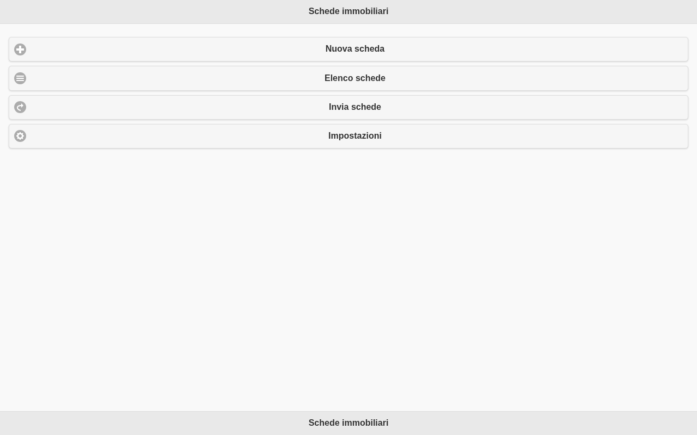
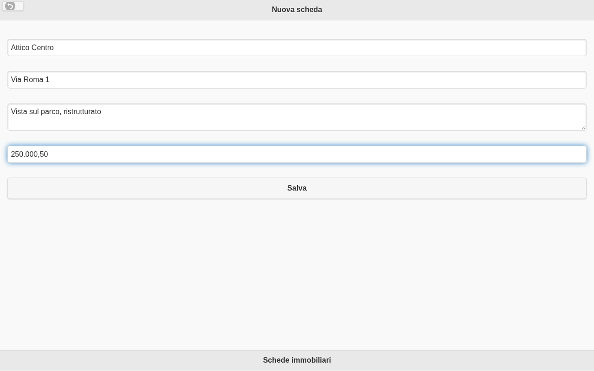
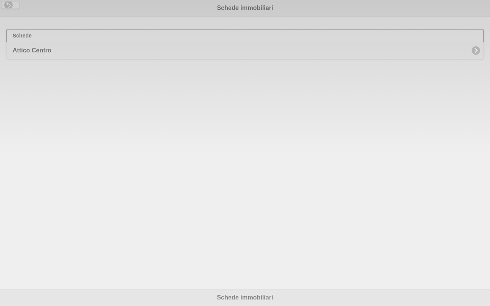
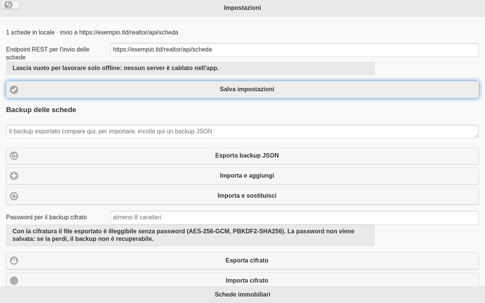

# Realtor

Gestione **offline-first** di schede immobiliari (nome, indirizzo, descrizione, prezzo):
un'unica base di codice per **web/PWA**, **Android** e **iOS**, con invio opzionale a un
endpoint REST configurato dall'utente e server di riferimento incluso.

[](https://github.com/donatopepe/Realtor/actions/workflows/ci.yml)
[](LICENSE)
[](package.json)

| Web/PWA | Nuova scheda | Elenco | Impostazioni |
|---|---|---|---|
|  |  |  |  |

> **English summary** — Realtor is an offline-first property-appraisal card manager
> (one codebase for web/PWA, Android and iOS): cards are stored locally, the REST
> endpoint used to upload them is configured by the user (empty = offline only) and a
> reference API server with tests and a Dockerfile is included. MIT licensed.

---

## Funzionalità

- Creazione, modifica, elenco ed eliminazione di schede immobiliari, salvate **solo sul dispositivo**.
- **Nessuna perdita di dati**: le schede vengono rimosse in locale soltanto dopo una risposta `2xx` del server.
- **Endpoint REST configurabile** dalla pagina Impostazioni; con campo vuoto l'app resta **offline** (nessun server cablato nel codice).
- **Backup**: esportazione/importazione JSON (aggiungi o sostituisci) con validazione *prima* di scrivere.
- **Migrazione** automatica delle schede salvate con la versione 0.0.1.
- Prezzi in formato italiano (`150.000,50`), nome scheda obbligatorio, limiti di lunghezza validati.
- **PWA installabile** con service worker: l'app si apre anche senza rete.
- Stessa interfaccia su Android e iOS tramite Cordova, con plugin nativi (dialoghi, stato rete) e fallback web.
- Server API di riferimento (Node, zero dipendenze) con archivio JSON atomico, Docker e health check.
- **Sicurezza**: CSP senza script inline, header di sicurezza, pinning SRI dei file dell'app,
  **backup cifrato** (AES-256-GCM + PBKDF2), rate limiting, audit log pseudonimizzato,
  scansione dei segreti su working tree e storia, SBOM, Dependabot e CodeQL in CI.
- **Test**: 207 unit/integration Node + 53 E2E passati (1 skip mobile-only screenshot).

## Requisiti

| Ambito | Requisiti |
|--------|-----------|
| Web/PWA | Node.js >= 22 (verificato con 26), un browser moderno |
| Test end-to-end | Chromium scaricato da Playwright (`npx playwright install chromium`) |
| Android | JDK 17, Android SDK (platform + build-tools 36) con `ANDROID_HOME` esportato |
| iOS | macOS con Xcode (la compilazione non è possibile su Linux/Windows) |
| Server/Docker | Node.js >= 22 oppure Docker |
| Icone | bash + ImageMagick (solo per rigenerare le icone) |

## Avvio rapido

Web (PWA), senza installare nulla oltre a Node:

```bash
npm ci
npm run serve
# apri http://localhost:8080
```

Per provarla da un telefono nella stessa rete:

```bash
npm run serve:lan
```

Server REST di riferimento (opzionale per provare l'invio):

```bash
npm run server
# API su http://localhost:3000
```

Nell'app: **Impostazioni** → Endpoint REST → `http://<ip-del-pc>:3000/realtor/api/scheda` → *Salva impostazioni*.
Il contratto completo è in [docs/API.md](docs/API.md).

## Test

```bash
npm test                  # unit + integrazione + server (171 test, node:test)
npm run test:coverage     # copertura (core e UI >= 90%)
npm run test:e2e          # end-to-end Playwright su desktop e mobile (39 test)
npm run server:test       # solo i test dell'API di riferimento
npm run lint              # ESLint su app, server, script e test
npm run scan:secrets      # scansione segreti nel working tree
npm run scan:secrets:history  # scansione segreti in tutta la storia git
npm run sri:check         # integrità dei file dell'app (hash SHA-384)
npm run sri:update        # aggiorna gli hash dopo modifiche legittime all'app shell
npm run audit:prod        # vulnerabilità nelle dipendenze di produzione
npm run audit:report      # report completo (inclusa la toolchain di sviluppo)
npm run sbom              # genera sbom.cdx.json (CycloneDX)
npm run docs:check        # verifica che la documentazione sia eseguibile
```

## Build

Android (APK debug, non firmato per la pubblicazione):

```bash
npm ci
npx cordova platform add android   # oppure: npm run prepare:android
npm run build:android              # APK in platforms/android/app/build/outputs/apk/debug/
```

iOS (richiede macOS):

```bash
npm run prepare:ios
npm run build:ios                  # oppure: cordova build ios --emulator
```

Web: `www/` è già la build — va servita staticamente (GitHub Pages, nginx, `npm run serve`).
Non usare `cordova platform add browser`: `cordova-browser` non è compatibile con questo package
ESM (`"type": "module"`).

Icone (PWA, densità Android, set iOS) generate dal logo:

```bash
npm run icons
```

## Server

```bash
npm run server                        # archivio JSON in ./data/cards.json
node server/src/server.js --memory    # archivio volatile, utile per una demo
npm run docker:build && npm run docker:run
```

Endpoint: `GET /health`, `GET|POST /realtor/api/scheda`. Token opzionale con
`REALTOR_API_TOKEN`, CORS con `REALTOR_CORS_ORIGIN`, limite corpo 1 MiB. Dettagli in
[docs/API.md](docs/API.md); pubblicazione in [docs/PUBLISHING.md](docs/PUBLISHING.md).

## Struttura

```text
www/                  unica base di codice servita a browser, Android e iOS
  index.html          UI jQuery Mobile (home, scheda, elenco, impostazioni)
  manifest.webmanifest / sw.js   PWA installabile e uso offline
  css/index.css
  img/                logo, icone PWA, favicon, apple-touch-icon
  js/app.js           collegamento fra UI e core
  js/platform.js      adapter Cordova + fallback web (dialoghi, rete, uscita)
  js/core/            schema, storage, api, settings, backup, migration (nessuna dipendenza)
server/               API REST di riferimento (Node senza dipendenze + Dockerfile)
tests/                unit/integration (node:test) ed end-to-end (Playwright)
scripts/              serve statico, icone, scansione segreti, verifica documentazione
resources/            icone native Android/iOS generate
docs/                 API, architettura, migrazione, pubblicazione, screenshot
config.xml            configurazione Cordova (android + ios, plugin, icone)
PLAN.md               piano di lavoro, criteri di accettazione e log delle verifiche
```

Architettura, flussi e scelte tecniche: [docs/ARCHITECTURE.md](docs/ARCHITECTURE.md).
Passaggio dalla 0.0.1: [docs/MIGRATION.md](docs/MIGRATION.md).

## Piattaforme

| Piattaforma | Stato | Come si ottiene |
|-------------|-------|-----------------|
| Web / PWA | ✅ verificata end-to-end (desktop + mobile) | `npm run serve` o hosting statico di `www/` |
| Android | ✅ APK debug costruito e verificato (minSdk 24, targetSdk 36) | `npm run build:android` |
| iOS | ✅ progetto e impostazioni pronti; compilazione in CI su macOS | `npm run build:ios` su macOS |
| Desktop (Electron) | ⏳ opzionale, non incluso nella v1.0.0 | blocco commentato in `config.xml` |

Nessun ramo condizionale per piattaforma nel codice: le differenze passano da
`www/js/platform.js` (feature detection) e il resto dell'app è identico ovunque.

## Risoluzione dei problemi

| Sintomo | Causa e rimedio |
|---------|-----------------|
| `cordova platform add android` dice "Platform android already added" | Esiste una cartella `platforms/android` non valida: rimuovila (`rm -rf platforms plugins`) e ripeti |
| La build Android non trova l'SDK | Esporta `ANDROID_HOME` (es. `export ANDROID_HOME=/opt/android-sdk`) e installa platform/build-tools 36 |
| Nel browser compare un 404 su `cordova.js` | Usa `npm run serve` (serve uno shim) oppure ignora: nel browser l'app usa i fallback web |
| I pulsanti non reagiscono su desktop | Aggiorna all'ultima versione: fino a M4 i comandi erano legati solo all'evento `tap` (touch) |
| `npm run test:e2e` chiede un browser | `npx playwright install chromium` |
| `cordova platform add ios` termina con "module is not defined in ES module scope" | Usa `npm run prepare:ios`: gestisce l'incompatibilità fra i file CommonJS di cordova-ios e `"type": "module"` |
| L'invio dice "Endpoint API non configurato" | È il comportamento previsto in modalità offline: imposta l'endpoint in Impostazioni |
| Il browser segnala violazioni CSP in console | È la policy attiva: apri una issue con il messaggio, non allentare la CSP per aggirarla |
| Backup cifrato: "Password errata o file danneggiato" | La password è diversa da quella usata per esportare, oppure il file è stato modificato: la cifratura autentica il contenuto e non restituisce dati parziali |

## Sicurezza

Realtor non ha telemetria e non richiede account: le schede restano sul dispositivo e l'invio è
opzionale, verso un endpoint configurato dall'utente. I controlli implementati (CSP, header,
pinning SRI, backup cifrato con password, rate limiting, audit log senza dati personali, scansione
segreti, SBOM, Dependabot, CodeQL, action pinnate a SHA), le verifiche ripetibili e i rischi
accettati sono descritti in [SECURITY.md](SECURITY.md).

Per segnalare una vulnerabilità non aprire una issue pubblica: scrivi a **contact@example.invalid**.

## Licenza

[MIT](LICENSE) © 2014-2026 Donato Pepe. Attribuzioni di terze parti in [NOTICE](NOTICE).
Contributi: [CONTRIBUTING.md](CONTRIBUTING.md) · sicurezza: [SECURITY.md](SECURITY.md).

## Note sul progetto

Questo repository nasce dall'app Cordova 0.0.1 del 2014, non più buildabile e con un bug di
perdita dati in "Invia schede". Il percorso di modernizzazione, i criteri di accettazione
(22) e il log delle verifiche con gli output dei comandi sono in [PLAN.md](PLAN.md);
le modifiche rilasciate in [CHANGELOG.md](CHANGELOG.md).
